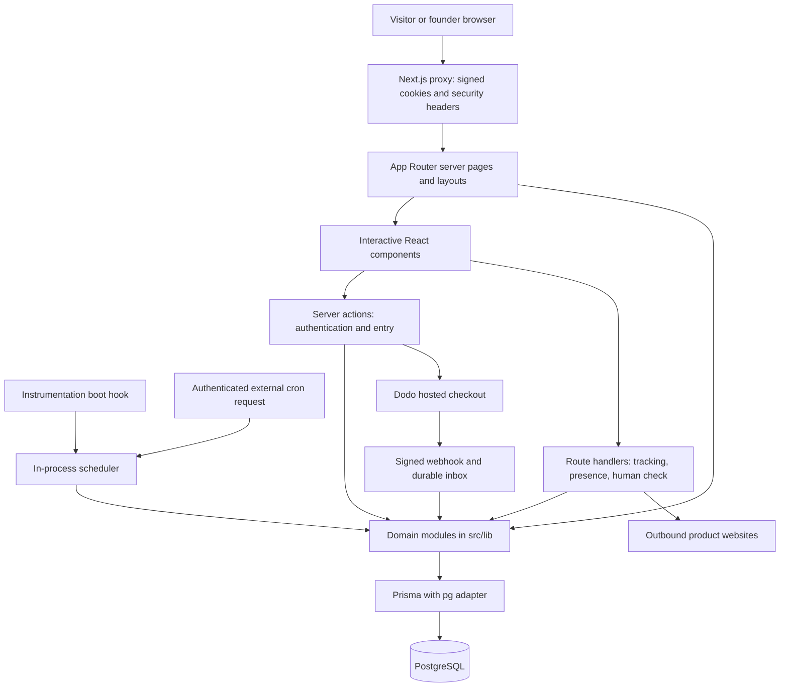

# Surviver.lol architecture

Verified against the local source on 6 October 2026. This document describes the current implementation, including historical structures that remain in the repository. It supersedes the earlier architecture map in this file; older prose in `README.md`, `codebase.md`, and source comments can describe a previous product format.

## 1. Product and system overview

Surviver.lol is a paid SaaS discovery and ranking platform. A founder submits a product URL and pays a season entry fee. Paid products appear in the public lineup while the field fills. Once all 32 spots are paid and eligible, everyone starts together. All products remain in the competition for one season-long ranking window. Verified outbound clicks determine live rank; at the deadline one product becomes the Survivor and the other eligible products receive final positions.

The application is a single Next.js full-stack application with PostgreSQL persistence. Pages, server actions, HTTP route handlers, and background lifecycle work share domain modules and the same Prisma client. There is no separate API service, administrator panel, message broker, Redis layer, or external authentication service in the main application.

The default newly seeded season costs USD 29 and runs for 720 hours (30 days). Price and duration live on the Season record. The database enforces 32 slots for seasons that have not started. Older running/completed/cancelled seasons may retain a historical field size.



## 2. Technology stack

Versions below are declarations from the root `package.json`; caret ranges are not exact installed-version claims.

| Layer | Technology | Role |
| --- | --- | --- |
| Runtime | Node.js >=22; Render blueprint selects 22 | Long-running application server, crypto, DNS, timers, scripts |
| Framework | Next.js 16.3.4 | App Router, Server Components, server actions, route handlers, proxy, instrumentation |
| UI | React / React DOM 19.2.8 | Server rendering and client interactivity; `useActionState` forms |
| Language | TypeScript ^5 | Strict typing, bundler module resolution, `@/*` alias to `src/*` |
| Styling | Tailwind CSS ^4 and `@tailwindcss/postcss` ^4 | Utility classes, CSS theme variables, responsive layouts |
| Fonts and icons | DM Sans, Geist Mono, `lucide-react` ^1.48.0, `simple-icons` ^16.33.0 | Typography and reusable SVG icon components |
| Database | PostgreSQL | Relational state, constraints, locks, event history, distributed rate limits |
| ORM / driver | Prisma / Prisma Client / PrismaPg ^7.10.0, `pg` ^8.23.0 | Generated typed client and PostgreSQL driver adapter |
| Validation | Zod ^4.5.4 | Server action input validation |
| Passwords | `bcryptjs` ^3.0.2 | Custom email/password login with bcrypt cost 12 |
| Webhook authentication | `standardwebhooks` ^1.1.1 | Dodo signature verification |
| Network validation | `ipaddr.js` ^2.5.0, Node DNS/HTTP/HTTPS APIs | Public-host checks, DNS-pinned metadata fetches, IPv6 network normalization |
| Payments | Dodo Payments REST API; local dev provider | Hosted checkout, settlement webhooks, refunds |
| Human verification | Cloudflare Turnstile | Optional production human pass for counted interactions |
| Quality tools | ESLint ^9, eslint-config-next 16.3.4, TypeScript, Node test runner, `tsx` ^4.23.13 | Lint, type checks, TypeScript unit/integration tests |
| Deployment configuration | Render web service; Supabase Postgres described in deployment docs | Node process hosting and hosted database connectivity |

Supabase is used as a PostgreSQL hosting option, not through a Supabase browser SDK or Supabase Auth. Dodo is called with `fetch`, without a Dodo SDK. Client state uses React hooks and a small entry event/cache module rather than a global state framework.

## 3. Repository map

| Path | Responsibility |
| --- | --- |
| `src/app/` | URL routes, layouts, loading/error UI, SEO endpoints, global styles |
| `src/components/` | Brand, layout, home, product, competition, entry, auth, security, and UI components |
| `src/lib/competition/` | Season availability, readiness, ranking, lifecycle, scheduler, standings, constants |
| `src/lib/tracking/` | Anonymous visitor context, impressions/clicks/Rally, site presence |
| `src/lib/products/` | Entry server actions and product website metadata |
| `src/lib/payments/` | Provider interface/adapters, checkout access, fulfillment, webhook inbox/retries, return URL |
| `src/lib/auth/` | Passwords, sessions, guards, auth actions, safe redirects |
| `src/lib/security/` | Capabilities/proofs, origins, public fetches, IP identity, rate limits, retention, text cleaning |
| `src/lib/db.ts`, `env.ts`, `seo.ts`, `format.ts`, `cn.ts` | Shared database, configuration, metadata, presentation helpers |
| `src/proxy.ts` | Anonymous identity cookies, Rally cookie, CSP nonce, response security headers |
| `src/instrumentation.ts` | Resume competition scheduling when a Node server instance starts |
| `prisma/schema.prisma` | Canonical relational schema |
| `prisma/migrations/` | Database evolution, including historical features and current constraints |
| `prisma/seed.ts` | Idempotently create Season 0 if missing; does not overwrite an existing season |
| `prisma/seed-demo.ts` | Retired demo seed; currently an empty export |
| `src/generated/prisma/` | Generated client; regenerate rather than hand-edit |
| `tests/` | Main application unit and database integration tests |
| `scripts/` | Security preflight, database diagnostics/token migration, icon/social asset generation, SEO audit |
| `design/` | Standalone HTML design explorations and stream overlay artifacts |
| `prompts/`, `videos/` | Supporting prompt/data and media artifacts |
| `render.yaml` | Render deployment blueprint |
| `MinecraftAntifravithy/`, `f1-car/` | Separate local projects; not integrated into the Surviver application |

## 4. Rendering and application boundaries

Server pages and layouts read database/domain state and render HTML/RSC output. Interactive components receive serializable props. `server-only` imports protect many modules that use the database, secrets, cookies, crypto, or server networking. Several pages also perform direct Prisma queries; the code does not enforce a repository abstraction for every read.

The root layout owns fonts, document metadata, global CSS, a nonce-bearing pre-paint theme script, and Organization/WebSite JSON-LD. The `(site)` layout composes the header/footer and streams in one shared EntryDialog and the human check using Suspense. `(auth)` provides a separate login/signup shell. Route groups do not appear in URLs.

Client responsibilities include the mobile navbar, category navigation, theme preference, countdowns, reveal/hover effects, entry preview/dialog, credential forms, impression observation, presence heartbeat, Turnstile, and error recovery. The database remains authoritative for paid slots, ownership, eligibility, scoring, and final results.

Server actions handle signup/signin/signout, metadata lookup, product entry, and local simulated checkout. Route handlers handle browser-facing HTTP ingestion, outbound redirects, provider callbacks, and cron. There is no WebSocket/SSE channel or client-side leaderboard polling loop in the current implementation: scoring updates live server state, while displayed standings refresh through rendering/navigation.

## 5. Route map

| URL | Purpose |
| --- | --- |
| `/` | Landing page, live ranking preview, available slots, lineup/board, presence, activity, URL entry |
| `/board` | Exposure-balanced discovery list, category filter, and paid upcoming lineup |
| `/leaderboard` | Click-ranked active standings; registration progress when no active standings exist |
| `/seasons` | Public season index |
| `/seasons/[number]` | Season detail and live/final standings; latest round fallback for archives |
| `/survivors` | Past winners |
| `/how-it-works`, `/rules` | Format and rules information |
| `/terms`, `/privacy`, `/sitemap` | Legal/information pages and human-readable site map |
| `/enter` | Redirect to `/?enter=1` to open the shared entry modal |
| `/enter/checkout/[paymentId]` | Capability-protected local dev checkout; unavailable as a production simulator |
| `/enter/complete` | Restore private campaign URL from the browser cookie after provider return |
| `/entry/[token]` | Campaign report authorized by a hashed, expiring, revocable capability |
| `/dashboard` | Campaigns owned by a signed-in account, plus the campaign authorized by this browser's guest cookie |
| `/login`, `/signup` | Custom credential authentication |
| `/go/[slug]` | Validate public product, optionally count interaction, redirect to its stored website |
| `/rally/[code]` | Validate Rally code and redirect to `/board?rally=...` |
| `POST /api/impressions` | Same-origin, proof-bound impression ingestion |
| `POST /api/presence` | Same-origin visitor heartbeat and counts |
| `POST /api/human` | Exchange Turnstile token for signed human-pass cookie |
| `POST /api/webhooks/dodo` | Verify, persist, claim, and process Dodo messages |
| `POST /api/cron/rounds` | Bearer-secret-protected scheduler reinforcement |
| `/robots.txt`, `/sitemap.xml`, `/social-card.png` | Search crawler policy, dynamic XML sitemap, generated social image |

Core stateful public pages use `force-dynamic`. Campaign/auth pages are excluded from indexing. Public season filters include registration-open, registration-closed, running, and completed seasons; drafts/cancelled seasons are excluded from the public season index/detail/sitemap.

## 6. Entry, checkout, and payment flow

1. QuickEntry or EnterButton opens the single EntryDialog through `entry-bus.ts`. URL lookups are debounced and reused in a per-tab Promise cache. The server metadata cache retains useful results for ten minutes, up to 500 entries.
2. `createEntryAction` validates and normalizes the URL, applies an entry request limit, and reads website metadata itself. It derives title, tagline, description, favicon, and cover; hostname-based defaults cover sites without metadata. New entries currently use category `AI`. Client-submitted names/categories/email/rules fields are not the current creation contract.
3. The action chooses the earliest available registration-open season. Inside a transaction it locks the season, checks dates/status, counts paid spots plus unexpired pending checkout holds, and rejects a duplicate blocking URL.
4. A signed-in founder owns the product. Otherwise the action creates a passwordless guest User with a generated internal email. It atomically creates Product (`DRAFT`), SeasonEntry (`AWAITING_PAYMENT`), and Payment (`PENDING`).
5. Checkout holds last two hours. Checkout and campaign capabilities are random 32-byte tokens; only hashes are stored. The campaign link expires after 90 days. Raw capabilities remain in HttpOnly browser cookies; the campaign cookie itself lasts two hours.
6. Provider checkout creation happens after the database transaction. Dodo product configuration is checked against the season's price/currency/business and required one-time settings; hosted checkout carries the internal payment ID in server-created metadata. If creation fails, cleanup attempts to fail the payment and withdraw/revoke the entry.
7. The provider redirects to `/enter/complete`, which restores `/entry/[token]` from the campaign cookie and clears the pending checkout cookie. A return redirect does not confirm payment.
8. The signed Dodo webhook is persisted in WebhookEvent before fulfillment. `applyPaymentResult` validates provider/payment identity, amount, currency, transition rules, and durable PaymentEvent deduplication under the same season lock.
9. Valid settlement marks Payment `SUCCEEDED`, entry `UPCOMING`, and product `APPROVED`. This publishes the listing immediately without manual review. If the final paid slot landed, fulfillment attempts `startSeason` immediately and activates the scheduler.
10. A payment that arrives after registration closes/full capacity, or after its entry was withdrawn, is recorded honestly and marked as refund owed. Refund requests run after commit and on later sweeps. Provider-confirmed full refunds withdraw/revoke non-final entries; partial refunds preserve their entry state.

Webhook records have processing/failed/review/processed/exhausted states. Claims prevent concurrent processing; claims older than five minutes can be recovered. Retries use exponential backoff from one minute, capped at 30 minutes, with eight attempts. Unknown/mismatched settlements remain reviewable; duplicate/already-settled messages are benign terminal outcomes. During registration, transient failures depend on provider redelivery because the recurring competition timer is gated on a full eligible or running field.

## 7. Season lifecycle and scoring

`competition/season.ts` distinguishes the current display season from the open season being sold. A running season wins display selection; sales may target a later open season. Availability counts both claimed entries and unexpired pending holds. Readiness requires exactly capacity-many paid, approved `UPCOMING` entries; pending holds do not start the season.

`engine.ts` uses PostgreSQL `SELECT ... FOR UPDATE` on the season row for lifecycle, scoring, and settlement serialization. Starting creates one active Round called `Live ranking`, with zero eliminations and an end time derived from `seasonLengthHours`. All eligible entries become `ACTIVE` and get zeroed ProductRoundStats.

`rankByClicks` sorts by verifiedVisits descending, then click rate descending, then entry ID for stable ordering. Equal click totals share live rank (for example 1, 2, 2, 4), regardless of the rate used to order rows within that tie. Rate is `verifiedVisits / qualifiedImpressions`, or zero with no impressions. A climbing rank is `RISING`; other live ranked rows are `SAFE`. There is no minimum impression threshold for current ranking.

At the deadline `advanceSeason` refreshes eligible stats, seals stats, closes the round/season, and assigns distinct final positions in the sorted order. The first product is `SURVIVOR`; others are `FINISHED`. Withdrawn entries retain history but are excluded from eligible final ranking. A season with no eligible entries closes without a winner.

`standings.ts` projects database records into StandingRow for UI consumption. Discovery uses `balanceForVisitor`: lower qualified-impression exposure is favored, a bounded Rally boost adjusts exposure weight, and visitor-seeded shuffling breaks exposure ties. The leaderboard uses rank order. Rally affects exposure rather than purchasing or directly adding rank points.

## 8. Tracking, human verification, and presence

The proxy sets signed anonymous visitor/session cookies and captures a Rally query code in a signed cookie. Visitor identity lasts one year; the browsing session and Rally cookies last a rolling two hours. Context resolution verifies signatures and derives a salted network hash from the configured trusted client-IP header. IPv6 addresses normalize to a /64; mapped IPv4 normalizes to IPv4.

ProductCard creates a signed interaction proof binding the entry, visitor, session, and issue time. Proofs expire after ten minutes. The ImpressionTracker requires at least 50% visibility in a foreground tab and schedules a request after about 1.1 seconds. The server requires at least 1,000 ms declared dwell, caps it at 60 seconds, and deduplicates qualified views over the season's configured interval (default 1,800 seconds).

A counted interaction requires signed visitor/session identity, a known network hash, a non-bot user agent, and a human pass when Turnstile is enabled. `/api/human` verifies with Cloudflare and issues a signed pass tied to that visitor for 12 hours. Production verification is enabled only when both keys exist; local defaults use Cloudflare test keys.

`/go/[slug]` only counts a click with a valid proof at least 1.5 seconds old. Live clicks also require a prior qualified impression. They deduplicate once per visitor/product/window and once per network/product/window. Certain excessive-identity traffic increments suspicious statistics. A referring founder's own Rally product does not score. Valid visits update aggregate stats and refresh ranks transactionally.

During registration, `LineupClick` records separate display-only traffic. It deduplicates per entry/visitor with an additional network check and uses the same counted-visitor/proof guards. It does not carry into competition scores. Unlike live scoring, its network check and insert are not under a season transaction; the visitor uniqueness constraint is the database-enforced deduplication boundary.

Rally visitors who qualify impressions on two distinct other products earn one Rally point for the referring active entry. SourceType distinguishes discovery, Rally, and Rally-self traffic. Self traffic is rejected before scoring event insertion.

Outbound navigation still works when proofs are absent, expired, too young, or tracking fails. Leaderboard/season-detail links currently omit proofs, so those outbound links navigate without increasing the verified click total.

Presence uses its own SiteVisitor table rather than competition events. The homepage renders initial counts, then its PresenceCounter sends foreground heartbeats every 60 seconds. Online means seen within three minutes; total means distinct stored visitor IDs. Presence accepts a signed non-bot identity without the stricter scoring human/network requirements.

## 9. Data model

`prisma/schema.prisma` is the source of truth. Tables use explicit snake_case mappings. Key relationships are:

```text
User --< Session
User --< Product --< SeasonEntry >-- Season
User --< Payment >-- Season
Season --< Round
SeasonEntry -- Payment (optional, unique)
SeasonEntry --< ProductRoundStats >-- Round
SeasonEntry --< ImpressionEvent / ClickEvent >-- Round
SeasonEntry --< LineupClick
SeasonEntry --< RallyVisitor
SeasonEntry / Round --< ActivityEvent (optional references)
Payment --< PaymentEvent
WebhookEvent, SiteVisitor, RateLimitBucket (standalone infrastructure tables)
```

| Model | Owns |
| --- | --- |
| User / Session | Founder identity, nullable guest password, hashed sessions, idle/absolute deadlines |
| Product | Destination, slug, scraped listing content, owner, category, publication status |
| Season | Pricing, capacity, registration dates, lifecycle, duration, tracking/exposure settings |
| SeasonEntry | Product participation, lifecycle, public Rally code, private hashed capability, final rank |
| Round | Scoring window and finalization; one window for new-format seasons |
| ProductRoundStats | Views, clicks, source totals, click rate, Rally points, rank/movement/status, frozen snapshot |
| ImpressionEvent / ClickEvent | Interaction evidence, identities, source, qualification, suspicion, network hashes |
| LineupClick | Registration traffic separate from ranking |
| RallyVisitor | Referral qualification and points per referring entry/visitor |
| Payment / PaymentEvent | Checkout/settlement identity, financial totals, holds, refund delivery state, durable idempotency |
| WebhookEvent | Authenticated provider payload inbox, claim/retry state and diagnostics |
| ActivityEvent | Lifecycle-generated feed messages |
| SiteVisitor | Anonymous first/last-seen presence |
| RateLimitBucket | Atomic distributed fixed-window request counts |

Important unique keys include email, product slug, season number, season/product participation, Rally code, manage/checkout token hashes, round/entry stats, entry/visitor lineup clicks, referring-entry/visitor attribution, and provider/payment identity. There is one Payment per linked entry. Historical elimination and manual-review enums/columns remain for existing records and compatible reporting; their presence does not mean those workflows are active.

## 10. Authentication and security

Authentication is custom: signup validates a minimum ten-character password and bcrypt's maximum 72 UTF-8 bytes, hashes with cost 12, creates a User, and opens a session. Login uses a dummy bcrypt comparison for unknown/passwordless users. There is no email-verification workflow, role model, password-reset route, or administrator UI in the current schema/routes.

The auth cookie contains a random token; Session stores SHA-256 only. Sessions expire after 24 hours idle, sliding on use, with an absolute seven-day limit. Dashboard queries restrict results to the authenticated owner and/or the browser's valid guest campaign capability. Private campaign pages verify hash, expiry, and revocation; the current campaign surface reports statistics rather than exposing product editing actions.

Other shared protections:

- CSP with a per-request script nonce, anti-framing headers, no-referrer policy, production HSTS, and private/no-store campaign/checkout responses.
- Same-origin checks and bounded bodies for browser POST APIs; authenticated bounded Dodo webhooks; constant-time cron/capability comparisons.
- PostgreSQL-backed atomic rate limits for signin, signup, entry creation, metadata lookup, and human verification; security-sensitive actions fail closed if their limit check fails.
- Metadata fetching validates every redirected host, rejects private/reserved addresses, pins the connection to the validated DNS address, and preserves hostname TLS checks. It bounds timeout, redirects, and head/body buffering.
- Text cleaning removes markup, controls, bidi/zero-width characters and normalizes/truncates scraped listing content.
- Production startup preflight enforces strong secrets, canonical HTTPS APP_URL, live Dodo configuration, and database/provider credentials.

These are implementation boundaries, not a claim that the application has undergone a fresh security audit or that browser identity perfectly identifies a person.

## 11. Scheduler, deployment, and configuration

`instrumentation.register` resumes the scheduler on Node server boot and skips production build execution. The scheduler uses a process-global 60-second timer and shares an in-flight tick between concurrent callers within that process. It activates only for a full eligible or already-running field and stops when no such work remains. Database season locks and conditional webhook claims protect shared state across processes.

A tick attempts owed refunds, checks whether competition work is eligible, retries due webhook messages, starts full seasons, and completes expired windows. Retention is attempted every 60 ticks or requested by cron, but only after the eligibility gate. Therefore the cron endpoint also returns early during an idle/unfilled registration season: forced retention does not bypass that gate. Retention clears old absolute-expired sessions, processed webhooks older than 90 days, expired rate-limit buckets, and sufficiently abandoned checkouts. SiteVisitor and raw competition-event retention are not implemented here.

The timer needs a live Node process; process suspension/downtime delays transitions. Boot recovery and an external call to `/api/cron/rounds` reinforce it. The Render blueprint defines a web service, not a separate cron service.

Render commands from `render.yaml`:

```text
build: npm ci && npm run db:hash-legacy-capabilities && npx prisma migrate deploy && npm run build
start: npm run start
```

`postinstall` regenerates Prisma. Start runs the security preflight before `next start`. `prisma.config.ts` loads `.env` for CLI configuration and optionally uses SHADOW_DATABASE_URL for local migration work. Runtime uses PrismaPg; development caches the client globally and retires it when the URL/generated constructor changes.

| Environment setting | Purpose |
| --- | --- |
| DATABASE_URL | Required PostgreSQL connection |
| APP_URL | Application public URLs/origin checks; production preflight requires `https://surviver.lol` |
| SECURITY_SECRET / IP_HASH_SALT / CRON_SECRET | Cookie/proof signing, network hashing, cron authorization; strong production values required |
| CLIENT_IP_HEADER | Ingress-overwritten client address header, default `x-forwarded-for` |
| PAYMENT_PROVIDER | Local `dev` or live `dodo`; dev forbidden in production |
| DODO_PAYMENTS_ENVIRONMENT | `test_mode` or `live_mode`; production requires live mode |
| DODO_PAYMENTS_API_KEY / DODO_PAYMENTS_WEBHOOK_KEY / DODO_PAYMENTS_PRODUCT_ID / DODO_PAYMENTS_BUSINESS_ID | Provider catalog, checkout, signature and business bindings |
| TURNSTILE_SITE_KEY / TURNSTILE_SECRET_KEY | Enable Cloudflare human verification when both configured |
| SHADOW_DATABASE_URL | Optional Prisma local migration shadow database |
| TEST_DATABASE_URL | Explicit throwaway migrated database for integration tests |

SEO canonical URLs use the constant `https://surviver.lol`, separately from APP_URL. `next.config.ts` permanently redirects the www hostname to the canonical hostname and disables the powered-by header. The social image uses Next ImageResponse with bundled DM Sans font assets. Robots/sitemap exclude private and tracking routes.

## 12. UI and ancillary project boundaries

`globals.css` defines Tailwind v4 theme tokens, category colors, light/dark overrides, typography, surfaces, animations, and reduced-motion behavior. Light is the server default; a nonce-bearing script restores remembered dark preference before paint. Reusable `components/ui` primitives handle buttons, fields, panels, badges/chips, icons, counters, and motion. Doodle components/styles remain but the root wallpaper is parked. The old multi-field EntryForm remains in source but has no current route import; EntryDialog is the active entry UI.

`design/` contains static prototypes and a standalone StreamElements to-do widget with HTML/CSS/JS, settings fields, persistence, chat command handling, and preview builder. YouTube/Discord reach claims in the main UI are promotional copy/links; no automated shout-out or livestream publishing integration exists in the main app.

`MinecraftAntifravithy/` is a standalone browser voxel project. Its actual source includes custom WebGL/shaders/texture synthesis/math/meshing, terrain/chunk/dimension/portal management, first-person physics, raycasting, block interaction, and separate browser/adversarial tests. Its project plan describes further inventory/crafting/entities/audio features; those planned modules must not be assumed implemented from the plan alone. It is neither imported by `src/` nor served as a Surviver route.

`f1-car/` is a procedural Blender Python car/studio/render/export project with modules for parts, materials, geometry, decals, cameras, and animation. Its independent `web/` viewer uses Three.js ^0.170.0 and Vite ^6.0.0, loads local GLB/decals, rebuilds materials and studio lighting, and offers orbit/camera/color/wheel controls. These dependencies belong to that subproject, not the Surviver frontend stack.

## 13. Verification and notes for future changes

Main commands are `npm run dev`, `npm run typecheck`, `npm run lint`, `npm test`, `npm run build`, and the `db:*`/security scripts in package.json. Tests use Node's test runner with `--conditions=react-server --import tsx` and serial test execution. Database integration suites skip without TEST_DATABASE_URL; use a throwaway database with migrations, because these tests create/modify competition/payment records and exercise lifecycle work.

The unit suites cover click ranking/ties, season readiness, text cleaning, safe redirects, URL/network validation, capabilities/proofs, provider configuration, and webhook policies. Integration suites cover checkout availability, payment lifecycle, scheduler activation, network/visitor lineup deduplication, and distributed rate limits.

Review verification on 6 October 2026: `npm run typecheck` completed without diagnostics; `npm test` passed 37 tests with zero failures and five database integration tests skipped. TEST_DATABASE_URL was explicitly cleared for that test process. No production build, deployed-service check, or database integration run was performed for this documentation update.

Known source/documentation mismatches relevant to the next change:

- Older README/codebase prose and several comments still describe elimination rounds, interest-rate ranking, email verification, or mandatory cron. Current behavior is defined by the source described above.
- Terms copy still describes pre-publication review although settlement currently auto-approves products.
- PendingState copy says an unpaid slot is not held, while an unexpired pending checkout now does hold capacity.
- The current URL-only action assigns category AI even though ten category filters and the old multi-field form remain.
- Completion does not create/provision the next season. The baseline seed creates only Season 0; subsequent seasons need provisioning through database/tooling.
- Live stats, payment confirmation, and scheduler behavior require database/runtime verification; static inspection alone does not verify the deployed service.

Change entry behavior in EntryDialog/entry-bus and products/actions; ranking in scoring/events/engine; availability in season/readiness plus database constraints; payments in provider/fulfillment/inbox modules; appearance in globals.css and reusable components. Keep season-lock ordering, financial validation, private-token boundaries, and finalized statistics consistent when changing those paths.
